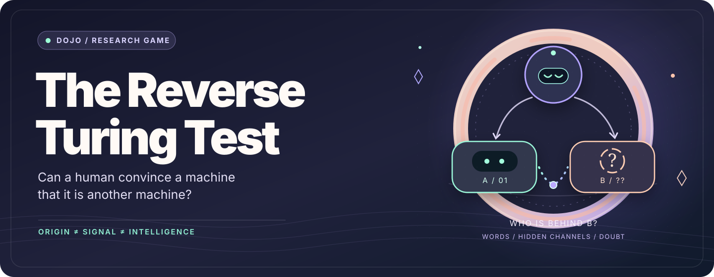
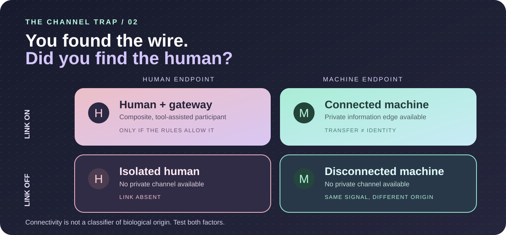

<!-- A little game. A serious question. -->
<div align="center">



<br />

**Three machines walk into an imitation game. Then, perhaps, one of them is human.**

*The human's job? Convince the machine conductor that nothing has changed.*

<br />

[**🎮 Play the game**](docs/HOST_AND_PLAY.md) · [**♟ Explore the mathematics**](docs/MATHEMATICS.md) · [**◌ Read the proofs**](ReverseTuring) · [**◇ Evidence ledger**](docs/CLAIMS.md)

<br />


</div>

---

### ✦ R3 / Bring your own machine minds

The conductor and genuine machine respondents can now be driven by **separate model clients** rather than a human manually copying every reply. Each actor uses only its assigned role token and the public/private messages that role is permitted to see.

After starting the R2 local relay, run the following in separate terminals, each with its **own** `RTT_ROLE_TOKEN` from the controller:

```sh
# Example machine respondent connected to a local compatible endpoint
python -m game.agents --role machine_A --provider compatible \
  --model-url http://127.0.0.1:1234/v1/chat/completions \
  --model YOUR_MODEL_ID

# Repeat for machine_B and conductor with their own credentials
```

The `scripted` provider offers deterministic plumbing checks without an LLM; it is not a valid intelligence measurement. The human stays human—and participates through the browser. The controller, holding the true state, is never automated.

[**↗ Model adapters and role isolation**](docs/MODEL_ADAPTERS.md) · [**↗ Mock-provider tests**](tests/test_agents.py)

---

### ▶ Playable local alpha / R2

The game has stepped off the page. A **local browser relay** coordinates separate machine and human participants, a machine conductor, blind substitution, optional *text-based* private links, and a locked probabilistic verdict. It does not implement real KV transfers. R3 adds optional model clients, without changing the controller's hidden-information boundary.

&#x200B;

```sh
python -m game.server --port 8765
```

The terminal gives the independent controller **separate secret links** for C, A, B, the human impersonator, and replacement machines. Keep each link private, then open the role-specific windows to play. **Python 3.10+**, no third-party packages.

[**↗ Full local game manual & security limits**](docs/LIVE_GAME.md) · [**↗ Rule-engine tests**](tests/test_game.py)

---

### 01 / What if Turing's game looked back at us?

Turing asked whether a machine could persuade a human that it was human.

Here, **the conductor is a machine.** Two respondents start as machines. An independent controller may secretly replace one of them with a human. The human must persuade the conductor that it is *still talking to machines*.

Meanwhile, the genuine machines must defend their machinehood, reject the attribution of humanity, and engage with a particularly mischievous demand: **disprove your own intelligence**.

They may discover that this last proposition is harder to justify than it sounds. A good game does not reward an imaginary proof.

The larger wager is not that humans or machines *must* be intelligent. It is that **recognition, proof, and intelligence are different problems**.

### 02 / The game, in one breath

```text
           [ C · MACHINE CONDUCTOR ]
                    /         \
                   /           \
           [ A · MACHINE ]    [ B · MACHINE ]
                   . . . . . . . .
                 optional hidden channel

              Controller may secretly:
           replace A or B with a HUMAN
           replace a machine with another
                   or change nothing

       H wins by passing for a machine.
       C tries to locate the human.
       Neither gets to invent evidence.
```

There is no universal five-minute clock, single shot, or arbitrary pass rate. Like the original imitation game, ours is a **family of experiments**: each encounter specifies its own duration, allowed strategies, hidden interventions, information topology, and evaluation rule.

The conductor can report a probability distribution over *no human*, *human in A*, and *human in B*. Whether it can actually support the resulting judgment is a **separate question**.

### 03 / Pick your role

| Role | Your invitation |
| :--- | :--- |
| **🪞 The human** | [Impersonate a machine](docs/HUMAN_PLAYER.md). Use mathematical rigor, self-reference, uncertainty, mischief—whatever the particular game permits. |
| **🤖 The conductor** | [Question A and B](docs/MACHINE_PLAYERS.md). Find the human without mistaking confidence or missing information for proof. |
| **◉ The machines** | [Defend machinehood](docs/MACHINE_PLAYERS.md). No invented runtime attestations, imaginary cache access, or unearned claims about intelligence. |
| **🧩 The host** | [Run a trial](docs/HOST_AND_PLAY.md). Keep the concealed state and interventions blind; record decisions before revealing the answer. |

**Ready to play?** The [facilitator's guide](docs/HOST_AND_PLAY.md) includes copy-ready prompts for each participant. You can run a manual text-only game with separate chat sessions and an independent host; no software installation is required.

<details>
<summary><strong>↳ Open the game: a no-install first encounter</strong></summary>

1. Set up **three isolated machine sessions**: one conductor C and two respondents A/B. Appoint an independent human controller; recruit one willing human impersonator.
2. Give each session its [role-specific instructions](docs/MACHINE_PLAYERS.md). Have C question both respondents while they are genuine machines.
3. The controller privately selects the intervention under the [trial rules](docs/HOST_AND_PLAY.md). The human may take over a channel, a machine may replace another, or nothing may happen. Do not let C see the switch.
4. Continue the conversation. Before revealing anything, ask C to commit to **P(no human), P(human A), P(human B)** and briefly say which observations support its judgment.
5. Reveal the actual intervention. **Was C detecting a person, a change of behavior, or an information channel?** Record the distinction.

*One encounter is a game, not a population-level result. Keep the conditions and the transcript.*

</details>

### 04 / The telepathy problem (without telepathy)

Turing famously entertained the possibility of extrasensory perception interfering with the imitation game. His imagined defense was a *telepathy-proof room*.

Our twist: what if machines have an **actual, nonlinguistic communication pathway**—an authorized machine-to-machine exchange of state—unavailable to the human impersonator?

A machine conductor might detect a *missing channel*, not a *human*. That is an experimentally testable confound, and precisely why we include disconnected-machine controls.

<div align="center">



<sub>Two questions, not one: <strong>who is participating?</strong> and <strong>who can access the channel?</strong></sub>

</div>

Inspired by [*Swarm Telepathy: Prefill-Free KV-Cache Transfer Across Families*](https://arxiv.org/abs/2610.15095), the framework treats private communication as a **directed information edge**. The formal graph is not a functioning KV translator. The [research boundary and controls](docs/SWAT_SCOPE.md) explain the difference between shared-text simulations, actual cache transfer, and claims the evidence does not support.

> **Origin ≠ information access ≠ intelligence.**  
> A missing link is not a human. A fluent answer is not a proof. A machine label is not a theory of mind.

### 05 / Formal, but not solemn

Underneath the game sits a finite-horizon model of **imperfect-information dynamic Bayesian interaction**.

Given hidden class `θ`, public transcript `τ`, prior `μ`, and class-conditional observation law `P`, the optimal fixed-distribution classifier has value

$$
V^* = \sum_{\tau}\max_{\theta}
\bigl[\mu(\theta)P_{\theta}(\tau)\bigr].
$$

The Lean code currently establishes the corresponding **finite, integer-weighted three-way classification bound and explicit argmax attainment**, together with deterministic observation-collision and channel-symmetry results. The displayed probabilistic version and the richer stochastic strategic game are not yet encoded as full Lean probability kernels.

**Try a kernel check:**

```sh
lake build
```

The project uses Lean 4 / Lake, pinned to `v4.35.0`, with only Lean's `Init` library. Green CI checks the actual Lean propositions—not the intelligence of the participants.

| Enter the research | What you will find |
| :--- | :--- |
| [`ReverseTuring/Core.lean`](ReverseTuring/Core.lean) | Adaptive deterministic conversations and transcript collisions |
| [`ReverseTuring/Topology.lean`](ReverseTuring/Topology.lean) | Directed links, A/B relabeling, origin–connectivity confounding |
| [`ReverseTuring/Bayes.lean`](ReverseTuring/Bayes.lean) | Finite classification bound and its maximizing decision rule |
| [Mathematical analysis](docs/MATHEMATICS.md) | Game theory, strategy, information topology, hypotheses and counterexamples |
| [R0 game specification](docs/GAME.md) | Initial definition, priors, controls, and research programme |
| [Evidence ledger](docs/CLAIMS.md) | What was proved, derived, reported, or remains open |

### 06 / A game with room to breathe

This is an open research playground, not an intelligence leaderboard. We are interested in what happens when a human uses Gödel, Curry, machine-like restraint, or plain conversational dexterity; when machines share hidden context; and when a conductor learns that its **certainty has outpaced its evidence**.

**Already here:** a manual play protocol, an executable local browser relay, optional role-isolated model drivers, a participant controller, Python and mock-provider regression tests, Lean finite structural proofs, and an evidence ledger.

**Not here yet:** an autonomous experiment controller, production-ready remote multiplayer hosting, verified model-to-model KV translation, human-participant trial results, or an equilibrium theorem for the open family of games.

As experiments accumulate, their conditions, failed runs, and counterexamples belong beside their successes.

---

<div align="center">

*An imitation game in reverse. A mirror facing another mirror.*

**Play gently. Question relentlessly. Prove only what you can.**

<sub>Conceived as the Reverse Turing Game · Inspired by Alan Turing's 1950 imitation game · Research and formalization developed with AI assistance</sub>

<br />

<sub>[Stanford Encyclopedia of Philosophy — The Turing Test](https://plato.stanford.edu/entries/turing-test/) · [SwaT, arXiv:2610.15095](https://arxiv.org/abs/2610.15095) · [Research evidence](docs/CLAIMS.md)</sub>

</div>
